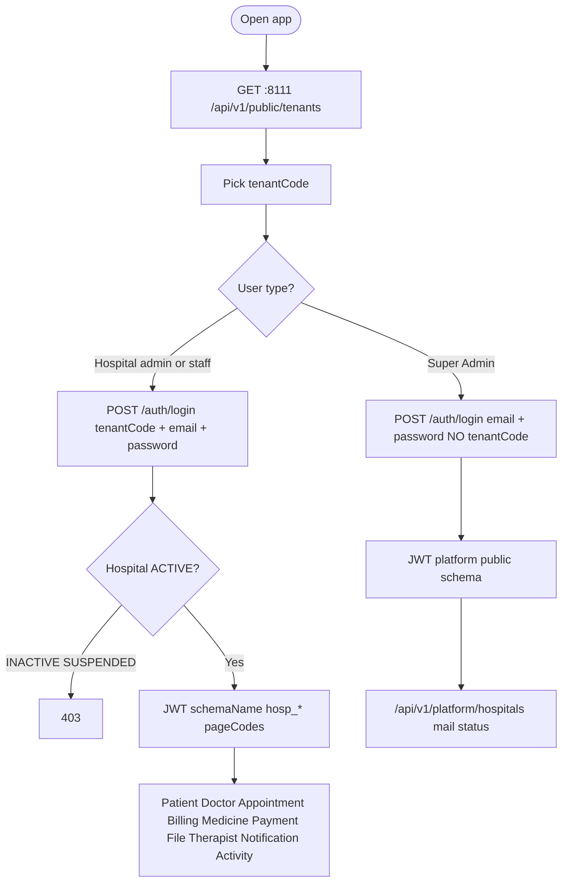
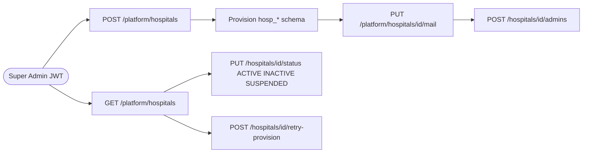
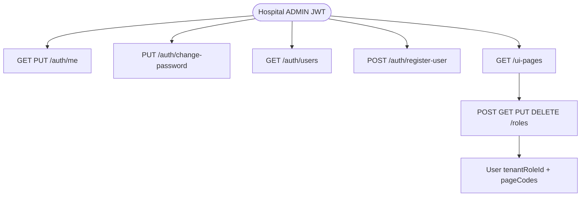
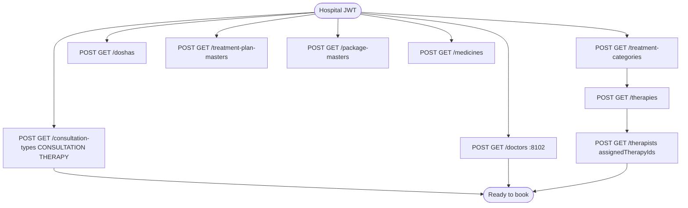
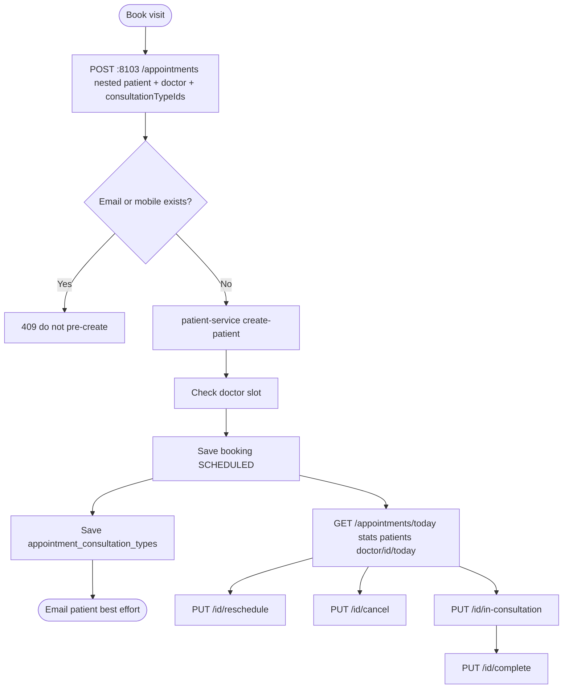
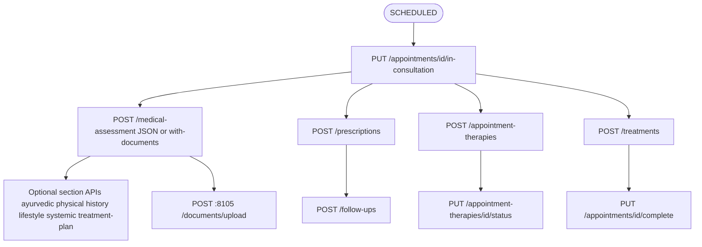
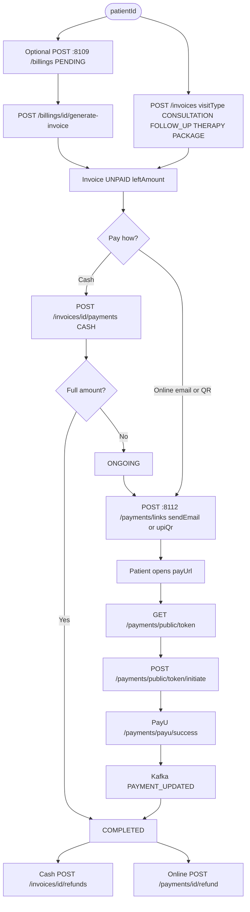
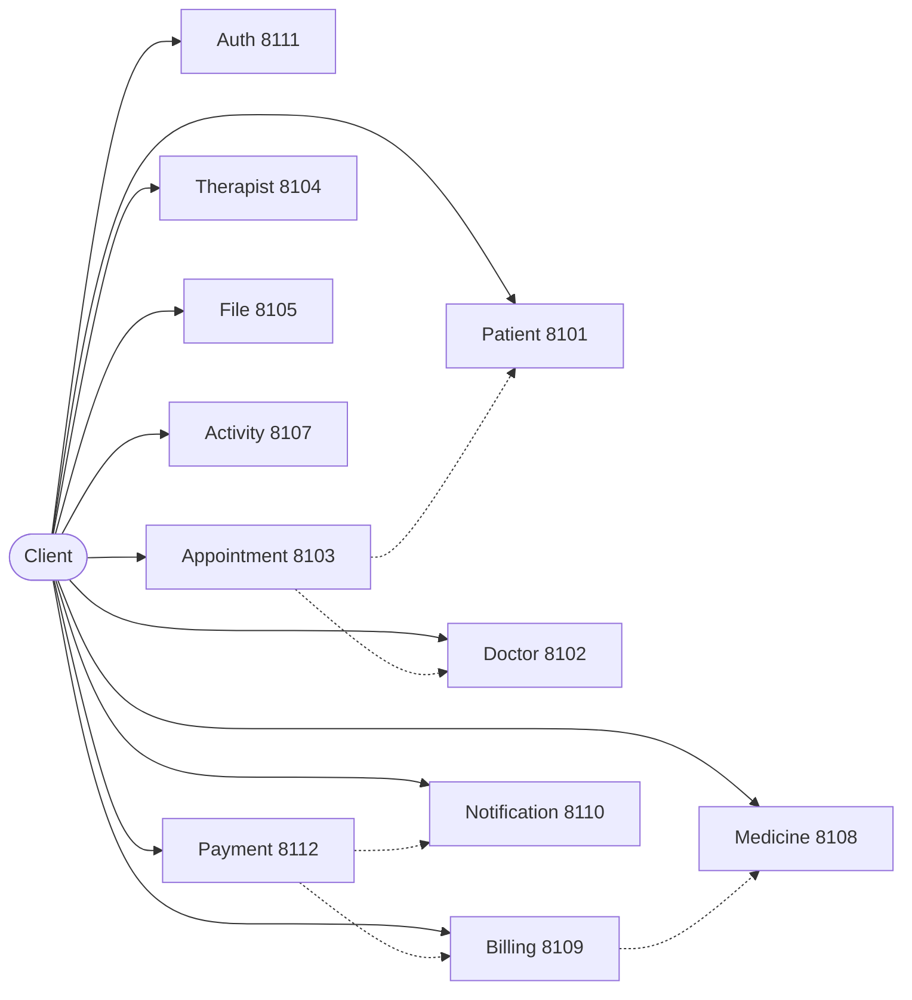
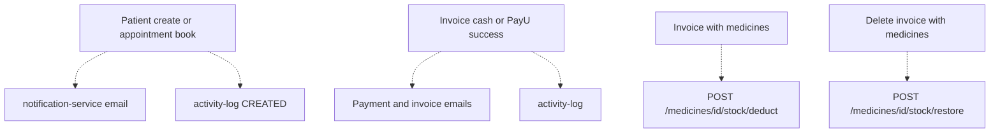

# Ayurvedaa API flow diagrams

All services except attendance. JWT on every hospital API unless marked public.

Companion: [FULL_API_DOCUMENT.md](./FULL_API_DOCUMENT.md)

---

## 1. Request path (every hospital API)

```mermaid
flowchart TD
  ui([UI or client]) --> login{Have JWT?}
  login -->|No| authLogin["POST auth :8111 /auth/login"]
  authLogin --> token[Store accessToken]
  login -->|Yes| token
  token --> call["Call service PORT + path with Authorization Bearer"]
  call --> jwt[JWT parsed schemaName hosp_*]
  jwt --> sa{schemaName hospital?}
  sa -->|No Super Admin| forbid[403 clinical APIs]
  sa -->|Yes| db[(Hospital schema tables)]
  db --> envelope[ApiResponse success status message data]
```

---

## 2. Auth: who logs in where



---

## 3. Super Admin hospital lifecycle



---

## 4. Hospital users and roles



---

## 5. Masters before booking



---

## 6. Appointment booking (creates patient)



---

## 7. In-clinic visit (appointment APIs)



---

## 8. Billing and payment



---

## 9. Service map (which port)



---

## 10. Side effects (email, logs, stock)



Attendance (`:8106`) is excluded.
